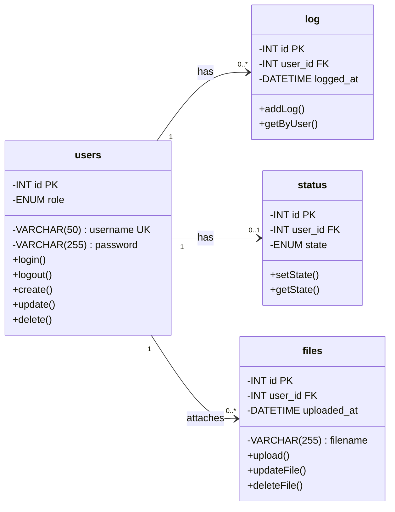

# Class Diagram & Database Schema (ฉบับแก้ไขสมบูรณ์ตามเกณฑ์)

เอกสารนี้แสดงแผนภาพ Class Diagram และโครงสร้างฐานข้อมูล (Database Schema) ที่ได้รับการปรับปรุงตามเกณฑ์มาตรฐานการออกแบบฐานข้อมูลและความสัมพันธ์

---

## 1. Class Diagram (Mermaid)



---

## 2. ตารางสรุปการแก้ไขตามเกณฑ์การประเมิน

| ข้อเกณฑ์ | สถานะเดิม | การแก้ไขในฉบับสมบูรณ์ |
|---|---|---|
| **1. มีอย่างน้อย 3 ตาราง** | ผ่าน | มี 3 ตารางครบถ้วน: `users`, `log`, `status` |
| **2. ความสัมพันธ์เหมาะสม** | ผ่าน | • ตัดเส้น `log` $\rightarrow$ `status` ออก<br>• เชื่อมโยงจาก `users` ไปยัง `log` (`1` ถึง `0..*`) และ `status` (`1` ถึง `0..1`) โดยตรง<br>• ระบุ Primary Key (PK), Foreign Key (FK), Unique Key (UK) ชัดเจน |
| **3. Data Type เหมาะสม** | ผ่าน | • กำหนดประเภทข้อมูลครบทุกคอลัมน์ของทั้ง 3 ตาราง<br>• `users`: `id` INT PK, `username` VARCHAR(50) UK, `password` VARCHAR(255), `role` ENUM<br>• `log`: `id` INT PK, `user_id` INT FK, `logged_at` DATETIME<br>• `status`: `id` INT PK, `user_id` INT FK UNIQUE, `state` ENUM |
| **4. Class Diagram สมบูรณ์** | ผ่าน | • มีองค์ประกอบ 3 ส่วนครบถ้วน: **ชื่อคลาส**, **Attributes**, **Methods**<br>• มีสัญลักษณ์ระดับการเข้าถึง: Attributes ใช้ `-` (Private), Methods ใช้ `+` (Public)<br>• มีชื่อความสัมพันธ์ (`: has`) และ Multiplicity กำกับที่ปลายเส้นความสัมพันธ์ |
| **5. การตั้งชื่อมาตรฐาน** | ผ่าน | • ใช้ `users` (พหูพจน์) แทนคำสงวน<br>• ใช้ `id` เป็น Primary Key และ `user_id` เป็น Foreign Key มาตรฐานเดียวกัน<br>• เปลี่ยน `status.status` $\rightarrow$ `status.state` (ลดความกำกวมระหว่างชื่อตารางกับชื่อฟิลด์)<br>• เปลี่ยน `log.time` $\rightarrow$ `log.logged_at`<br>• เปลี่ยน `pass` $\rightarrow$ `password`<br>• ยึดรูปแบบ `snake_case` ตลอดทั้งระบบ |

---

## 3. SQL DDL ที่สอดคล้องกับ Class Diagram

```sql
-- 1. ตาราง users
CREATE TABLE users (
  id INT AUTO_INCREMENT PRIMARY KEY,
  username VARCHAR(50) NOT NULL UNIQUE,
  password VARCHAR(255) NOT NULL,
  role ENUM('admin','editonly','readonly') NOT NULL DEFAULT 'readonly'
);

-- 2. ตาราง log (ประวัติการเข้าสู่ระบบ)
CREATE TABLE log (
  id INT AUTO_INCREMENT PRIMARY KEY,
  user_id INT NOT NULL,
  logged_at DATETIME NOT NULL DEFAULT CURRENT_TIMESTAMP,
  FOREIGN KEY (user_id) REFERENCES users(id) ON DELETE CASCADE
);

-- 3. ตาราง status (สถานะออนไลน์/ออฟไลน์)
CREATE TABLE status (
  id INT AUTO_INCREMENT PRIMARY KEY,
  user_id INT NOT NULL UNIQUE,
  state ENUM('on','off') NOT NULL DEFAULT 'off',
  FOREIGN KEY (user_id) REFERENCES users(id) ON DELETE CASCADE
);
```

> **คำอธิบายเพิ่มเติมทางเทคนิค:**
> - `status.user_id` กำหนด `UNIQUE` เพื่อรองรับความสัมพันธ์แบบ **1 ต่อ 0..1** (1 user มีสถานะได้สูงสุด 1 แถว)
> - `log.user_id` ไม่กำหนด `UNIQUE` เพื่อรองรับความสัมพันธ์แบบ **1 ต่อ 0..\*** (1 user มีประวัติล็อกอินได้หลายครั้ง)
> - `ON DELETE CASCADE` ช่วยรักษา Referential Integrity เมื่อลบผู้ใช้ ระบบจะลบประวัติ `log` และ `status` อัตโนมัติ
