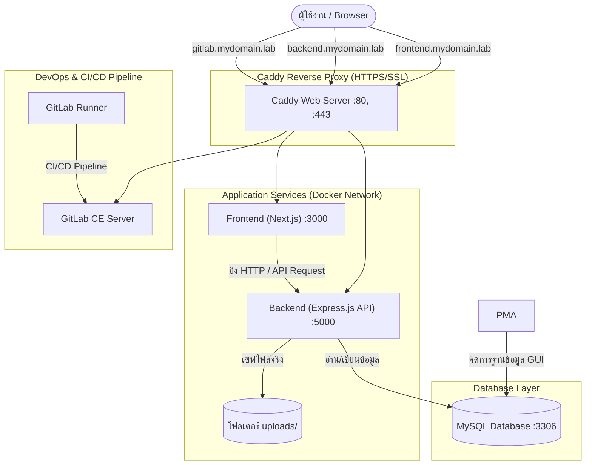
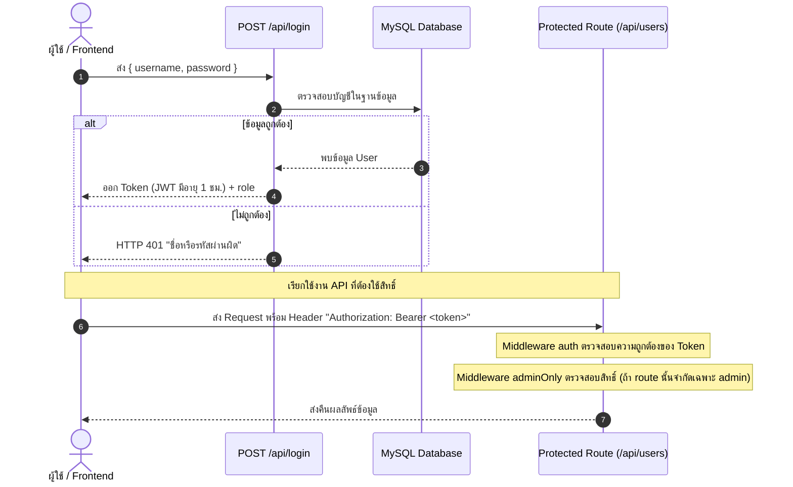
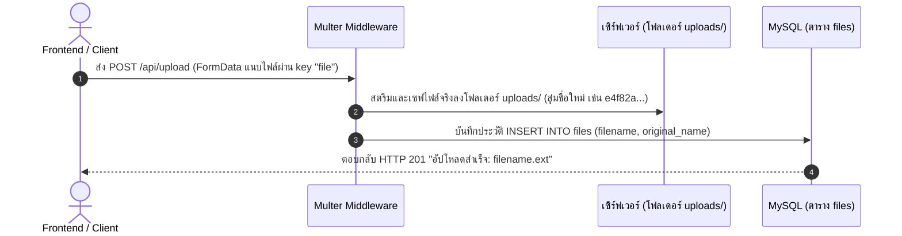
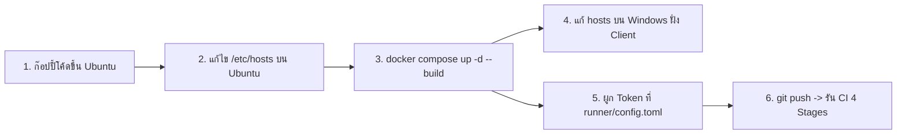

# สรุปภาพรวมและสถาปัตยกรรมการทำงานของระบบ (System Architecture)

เอกสารนี้อธิบายสถาปัตยกรรมและกระบวนการทำงานของระบบทั้งหมดในโปรเจกต์ ทั้งฝั่ง Infrastructure, Backend API, Database, และ Frontend

---

## 1. แผนภาพสถาปัตยกรรมภาพรวม (Architecture Overview)

---

## 2. รายละเอียดการทำงานของแต่ละส่วน

### 2.1 Reverse Proxy & Domain Routing (Caddy)
* **ไฟล์ตั้งค่า:** `Caddyfile`
* ทำหน้าที่เป็นประตูหน้าสุด (Gateway) รองรับ SSL/HTTPS แบบ Local อัตโนมัติ (`local_certs`)
* แจกจ่าย Request ตามชื่อโดเมน:
  * `frontend.mydomain.lab` $\rightarrow$ ส่งต่อไปยัง Next.js Frontend (`frontend:3000`)
  * `backend.mydomain.lab` $\rightarrow$ ส่งต่อไปยัง Node.js Express API (`app:5000`)
  * `gitlab.mydomain.lab` $\rightarrow$ ส่งต่อไปยัง GitLab (`gitlab:80`)
  * `registry.mydomain.lab` $\rightarrow$ ส่งต่อไปยัง GitLab Container Registry (`gitlab:5050`)

---

### 2.2 โครงสร้างฐานข้อมูล (MySQL + Auto-Init)
* **ไฟล์ตั้งค่า:** `config/db.js`
* ฐานข้อมูลชื่อ `my_app` รันผ่าน Docker container `db`
* **ระบบเริ่มต้นข้อมูลอัตโนมัติ (Auto Initializer)** เมื่อเปิด Backend ขึ้นมา:
  1. สร้างตาราง `users` อัตโนมัติ:
     * `id`: INT AUTO_INCREMENT PRIMARY KEY
     * `username`: VARCHAR(50) NOT NULL UNIQUE
     * `password`: VARCHAR(255) NOT NULL
     * `role`: ENUM('admin','editonly','readonly') NOT NULL DEFAULT 'readonly'
  2. สร้างตาราง `log` อัตโนมัติ:
     * `id`: INT AUTO_INCREMENT PRIMARY KEY
     * `user_id`: INT NOT NULL (FK -> users.id, ON DELETE CASCADE)
     * `logged_at`: DATETIME NOT NULL DEFAULT CURRENT_TIMESTAMP
  3. สร้างตาราง `status` อัตโนมัติ:
     * `id`: INT AUTO_INCREMENT PRIMARY KEY
     * `user_id`: INT NOT NULL UNIQUE (FK -> users.id, ON DELETE CASCADE)
     * `state`: ENUM('on','off') NOT NULL DEFAULT 'off'
  4. Seed ข้อมูลผู้ใช้เริ่มต้น 3 บัญชี:
     * `admin` / `admin` (Role: `admin`)
     * `editor` / `editor` (Role: `editonly`)
     * `user` / `user` (Role: `readonly`)

---

### 2.3 ระบบยืนยันตัวตนและความปลอดภัย (Authentication & Middleware)
* **ไฟล์ตั้งค่า:** `routes/auth.routes.js` และ `middlewares/auth.middleware.js`
* ใช้ระบบ **JWT (JSON Web Token)** ในการยืนยันตัวตน:

---

### 2.4 ระบบจัดการผู้ใช้ (User Management API)
* **ไฟล์ตั้งค่า:** `routes/user.routes.js`
* มีการแบ่ง Role อย่างชัดเจน:

| Method | Endpoint | สิทธิ์เข้าถึง | คำอธิบาย |
|---|---|---|---|
| `GET` | `/api/users` | `auth` (ทุกคนที่ล็อกอิน) | ดูรายชื่อผู้ใช้ทั้งหมด |
| `GET` | `/api/users/:id` | `auth` (ทุกคนที่ล็อกอิน) | ดูข้อมูลผู้ใช้ตาม ID |
| `POST` | `/api/users` | `adminOnly` | เพิ่มผู้ใช้ใหม่ |
| `PUT` | `/api/users/:id` | `adminOnly` | อัปเดตข้อมูลผู้ใช้ทั้งหมด |
| `PATCH` | `/api/users/:id` | `adminOnly` | เปลี่ยนเฉพาะ Username |
| `DELETE` | `/api/users/:id` | `adminOnly` | ลบผู้ใช้ออกจากระบบ |

---

### 2.5 ระบบอัปโหลดไฟล์ (File Upload Workflow)
* **ไฟล์ตั้งค่า:** `index.js` (Endpoint: `POST /api/upload`)
* **เทคโนโลยี:** `multer` ร่วมกับ MySQL

> **หมายเหตุสำคัญ:**  
> ตัวไฟล์จริงจะถูกเก็บในโฟลเดอร์ `uploads/` บนฮาร์ดดิสก์/Container เท่านั้น ส่วนฐานข้อมูล MySQL จะเก็บเพียงข้อมูลอ้างอิง (Metadata: ชื่อไฟล์สุ่ม และชื่อเดิม) เท่านั้น เพื่อไม่ให้ฐานข้อมูลทำงานหนักเกินไป

---

### 2.6 ระบบ Frontend
* **โฟลเดอร์:** `frontend/`
* พัฒนาด้วย **Next.js (React 19)**
* ทำหน้าที่เป็นหน้าต่างให้ผู้ใช้ล็อกอิน, รับ Token มาเก็บไว้ที่เบราว์เซอร์, นำ Token ไปเรียกใช้งาน API เพื่อแสดงผลรายชื่อผู้ใช้, และมีหน้าฟอร์มอัปโหลดไฟล์

---

### 2.7 ระบบ CI/CD & Version Control
* **ไฟล์ตั้งค่า:** `.gitlab-ci.yml`, `runner/config.toml`, `docker-compose.yml`
* ใน Docker Compose ประกอบด้วย:
  * **GitLab CE**: เซิร์ฟเวอร์เก็บโค้ดส่วนตัว (Self-hosted Git Server)
  * **GitLab Runner**: ตัวรัน Pipeline อัตโนมัติเมื่อมีการ `git push` โค้ด
  * **phpMyAdmin**: เครื่องมือเปิดดู/จัดการฐานข้อมูล MySQL ผ่านหน้าเว็บพอร์ต `8080`
* **GitLab CI Pipeline (4 Stages):**
  1. `build`: Build Docker Image จาก Dockerfile
  2. `test`: รัน Unit, Integration และ E2E Test (`npm test`) ด้วย Node.js 20
  3. `push`: Login เข้า Container Registry และ Push Image ขึ้น `registry.mydomain.lab`
  4. `deploy`: ดึง Image ล่าสุดลงมา Deploy (เฉพาะ branch `main`)

---

## 3. สรุปพอร์ตและการเข้าถึง (Network & Port Mappings)

| บริการ (Service) | Container Name | พอร์ตภายใน Container | พอร์ตภายนอก Host | URL / Domain HTTPS |
|---|---|---|---|---|
| **Caddy Gateway** | `caddy` | `80`, `443` | `80`, `443` | เข้าผ่าน HTTPS ทุกโดเมน |
| **Frontend Web** | `frontend` | `3000` | `3001` | `https://frontend.mydomain.lab` หรือ `http://<IP>:3001` |
| **Backend API** | `app` | `5000` | `5000` | `https://backend.mydomain.lab` หรือ `http://<IP>:5000` |
| **MySQL Database** | `db` | `3306` | `3306` | เชื่อมต่อผ่านโปรแกรมจัดการ DB |
| **phpMyAdmin** | `phpmyadmin` | `80` | `8080` | `http://<IP>:8080` |
| **GitLab CE** | `gitlab` | `80`, `5050` | ภายใน Caddy | `https://gitlab.mydomain.lab`, `https://registry.mydomain.lab` |
| **GitLab Runner** | `gitlab-runner` | - | - | ทำงานเบื้องหลัง เชื่อมกับ GitLab ผ่าน Socket Docker |

---

## 4. ลำดับกระบวนการเมื่อนำไปติดตั้งบน Ubuntu (Deployment Life Cycle)

1. **ขั้นรัน Container (`docker compose up -d --build`):** Container ทุกตัว (Frontend, Backend, DB, Caddy) ถูกสร้างและเปิดทำงานพร้อมกัน
2. **ฝั่ง Client (Windows):** เพิ่ม IP Ubuntu ลงใน `C:\Windows\System32\drivers\etc\hosts` เพื่อให้เครื่องคอมเข้าถึงชื่อโดเมน `.lab` ได้
3. **ฝั่ง CI/CD:** นำ Token จาก GitLab ไปใส่ใน `runner/config.toml` แล้ว `docker compose restart gitlab-runner` จากนั้น `git push` โค้ดเพื่อตรวจผล Pipeline ผ่านทั้ง 4 Stages

